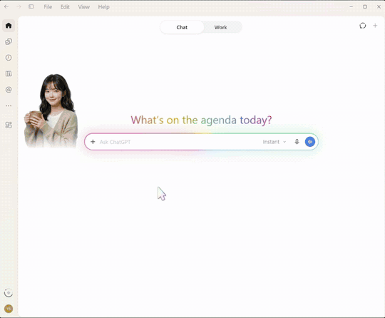
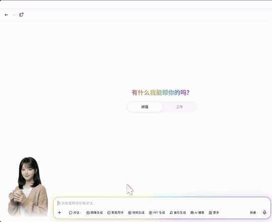
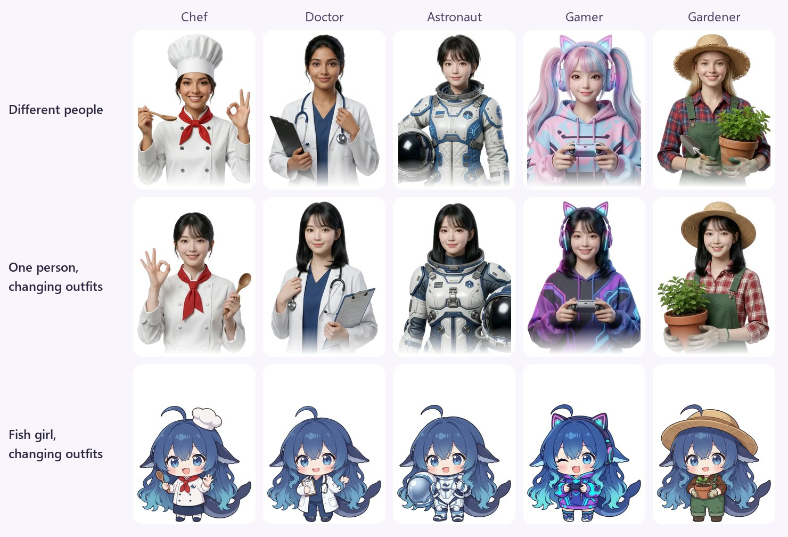
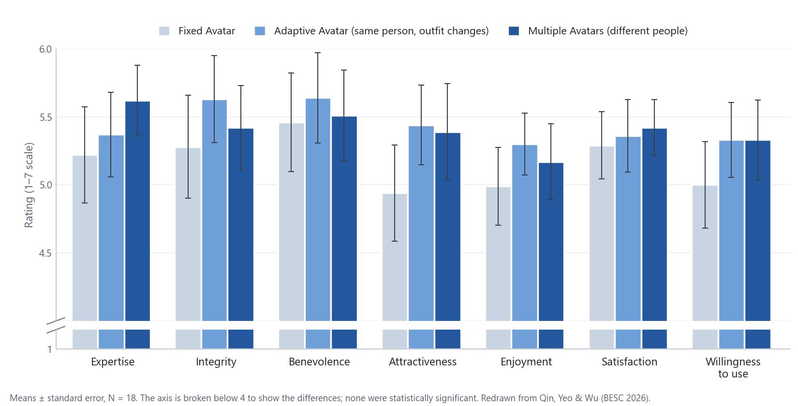
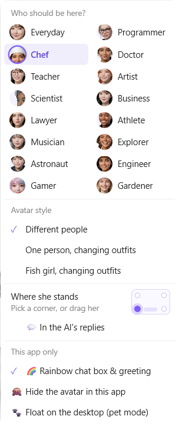
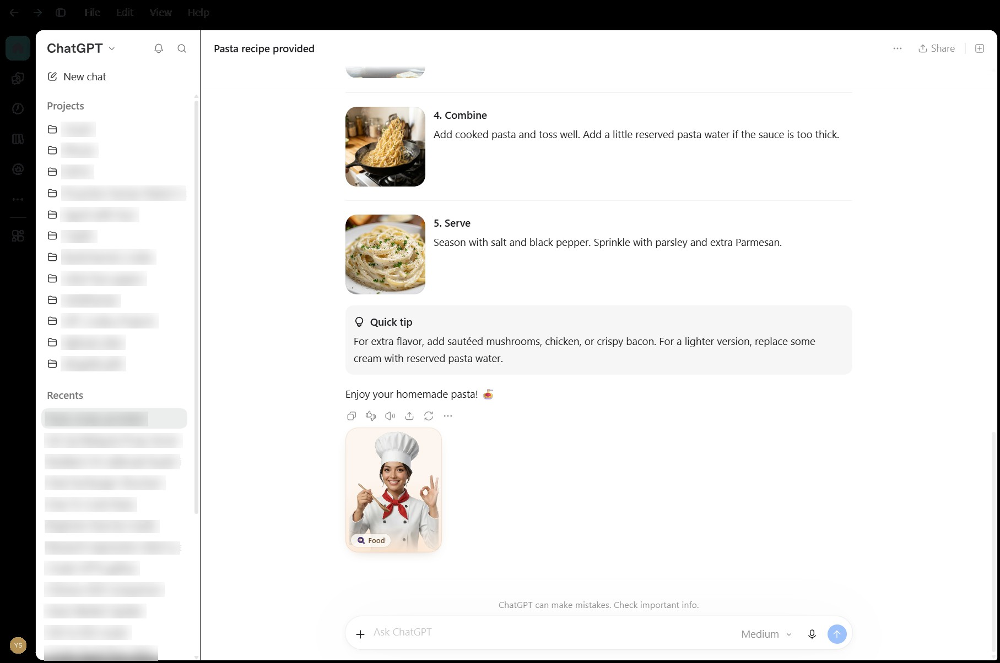

<p align="center"><b>English</b> | <a href="README.zh-CN.md">简体中文</a></p>
<h1 align="center"><br>Adaptive Agent Avatar</h1>

<p align="center">
<a href="#install-the-ready-to-run-zip"></a>
<a href="#macos-experimental"></a>
<a href="#android-experimental"></a>
<a href="#browser-extension-chrome-or-edge"></a>
</p>

<p align="center">
<a href="#supported-apps"></a>
<a href="#supported-apps"></a>
<a href="#supported-apps"></a>
<a href="#supported-apps"></a>
<a href="#supported-apps"></a>
<a href="#supported-apps"></a>
<a href="#supported-apps"></a>
<a href="#supported-apps"></a>
</p>

An Adaptive Avatar for AI chat that **changes its profession to match what you're asking about**.<br>
🍳 Ask how to cook fried rice and a **chef** walks in. &nbsp;🩺 Ask about knee pain and a **doctor** takes her place. &nbsp;🚀 Ask whether people could live on Mars and an **astronaut** arrives.

We know a human-like character makes an AI feel friendlier and easier to talk to than a plain text box, so we gave the AI one. Then we took it a step further: she changes profession to match the topic you ask about, so it feels like talking to the right expert. An avatar dressed for the subject may make the AI's answers feel more knowledgeable and trustworthy. The idea comes from [our research paper](#the-research-behind-it).

<table>
<tr>
<td width="41%"></td>
<td width="41%"></td>
<td width="18%"></td>
</tr>
<tr>
<td align="center"><b>In Codex:</b> pasta brings the chef, a fever the doctor, the Moon the astronaut</td>
<td align="center"><b>In Doubao:</b> Mandy dresses as a gamer, then a musician, then a teacher</td>
<td align="center"><b>In Android ChatGPT</b></td>
</tr>
</table>

This isn't really a pet. She can float on desktop like one, but doesn't ***yet*** wander around or play.

**Private by design.** The avatar **never** connects to the internet. A small AI model (Google's EmbeddingGemma, 130 MB) picks the topic of each question on your own processor, in tens of milliseconds, and your questions are never saved or sent anywhere. We chose a small model so it's fast on any PC; it can be swapped for a bigger one to pick topics more accurately. The desktop pet runs in a locked-down sandbox with no network or file access.

> **Unofficial and not affiliated with ByteDance, OpenAI, Tencent, Alibaba, Anthropic, Moonshot AI (Kimi), Cursor or DeepSeek.** It modifies the app’s page on your PC, which the app’s terms may not allow. Use at your own risk.
>
> Early test version: please try it and report bugs or ideas. The rainbow ring can be turned off.

## Quick start

1. Download **`AdaptiveAgentAvatar-v0.1.0-win-x64.zip`** from the [**Releases**](../../releases) page and extract it (details in [Install](#install-the-ready-to-run-zip)).
2. Double-click **`Install.bat`**. It adds an **AI Avatar** shortcut (Desktop and Start menu) and opens her icon.
3. Click her icon: it lists your installed apps. Click one to open it with her, for example *Doubao: closed - click to open with avatar*. Next time, start from the **AI Avatar** shortcut.
4. Chat as usual, and right-click her to change the style, where she stands, and more.

**Other platforms:** there are early Android and macOS apps (see [Android (experimental)](#android-experimental) and [macOS (experimental)](#macos-experimental)).

Using AI chat websites in Chrome or Edge? Get the [browser extension](#browser-extension-chrome-or-edge) instead.

## Supported apps

Eight Windows desktop apps, plus AI chat websites in Chrome or Edge. The avatar joins each one in one of four ways, depending on what the app allows:

| How she joins | Apps (tested version) | Turn her on | How it works |
|---|---|---|---|
| **Inside the app** | ChatGPT Codex Desktop App (26.1027, Microsoft Store)<br>Doubao 豆包 Desktop App (2.32)<br>Yuanbao 元宝 Desktop App (2.90)<br>Qianwen 千问 Desktop App (5.1)<br>Cursor Desktop App (3.19) | Tray icon → the app | Opens the app with its debugging port on and adds her to its page, beside the chat box. The app isn't changed. |
| **Overlay window** | Claude Desktop App (4.4212)<br>Kimi Desktop App (3.2) | Tray icon → Claude or Kimi | They don't let her into their page, so she stands on their window. A helper reads it the way screen readers do. |
| **Plugin** | DeepSeek Harness Desktop App (0.2) | Tray icon → DeepSeek Harness | Added through DeepSeek Harness's own plugin system. |
| **Browser extension** | ChatGPT, Claude, Doubao 豆包, Kimi, Qwen, Qianwen 千问, Yuanbao 元宝 (Chrome 156), plus almost any AI chat site you can add using the button in the extension | a separate download | Works on the listed sites straight away. On another site: her toolbar button → **Add to this site**. |

**Floating on the desktop:** in every app except the browser, right-click her → **🐾 Float on the desktop** (for Claude: **Float freely on the desktop**). Her right-click menu brings her back.

## What it does

- **An expert for every topic.** There are 16 topics: Coding, Food, Health, Writing, Art, Research, Study, Business, Law, Fitness, Music, Travel, Space, Engineering, Games and Gardening. When the topic changes, the current expert leaves and the right one arrives. A follow-up such as "tell me more" keeps the same expert. New chats and small talk, such as a greeting, the time or today's weather, get the everyday look.
- **Three styles** (right-click her → *Avatar style*):
  - **Different people:** a different expert for each topic. When the topic changes, the current expert walks out and the next one walks in, as if she's inviting a colleague to take over your question.
  - **One person, changing outfits:** the same woman, Mandy (小曼), who spins and changes into the right outfit. The spin isn’t perfect yet: I plan to improve and re-render it, but I’ve run out of rendering credits for now.
  - **Whale Girl, changing outfits:** Whale Girl (大肥鱼), a cute chibi fish girl in the same 16 outfits. She also needs improving and re-rendering, for the same reason.
- **Each has a name**, on a small plate under her. In *Different people* every expert has her own, for example Lucía the chef, Ada the programmer and Stella the astronaut; hover over a face in her menu to see it.
- **She reacts to the AI.** Thinking: a glass bubble with dots. Writing: lines draw themselves. Done: she nods and a tick appears. The bubbles follow the app's light or dark theme.
- **Pet mode.** She can leave the app window and float on your desktop (not in the browser version). She still changes with the topic and reacts to the AI there.

<p align="center"></p>

## The research behind it

This project grew out of our study:

> Ziyang Qin, [Hui-Shyong Yeo](https://hci-yeo.github.io/) and Man Wu. **Exploring the Effects of Avatar Attire Adaptation on User Perceptions of an LLM-Based Chatbot Across Professional Domains.** In *Behavioural and Social Computing (BESC 2026)*, Lecture Notes in Computer Science 17177, Springer, 2027. [doi:10.1007/978-981-92-6916-7_18](https://doi.org/10.1007/978-981-92-6916-7_18)

**Why we did it.** A human-like avatar makes a chatbot feel friendlier and easier to talk to than a plain text box. In one session, people now ask the same chatbot for help with very different things: a recipe, a design, some code, a story. Yet the chatbot usually shows one fixed avatar. Giving each task its own agent (a "multi-agent" design) signals expertise, but it breaks the feeling of talking to one consistent assistant. We asked whether there's a middle way: keep the same face, so the identity stays continuous, and change only the attire to match the task.

**What we tested.** 18 participants worked with an LLM chatbot on tasks in four domains (cooking, visual design, coding and creative writing, with a chef, painter, programmer and writer avatar). Each participant tried all three conditions:

- **Fixed Avatar:** one avatar that never changes.
- **Adaptive Avatar:** the same person in a new outfit for each task (the *One person, changing outfits* style).
- **Multiple Avatars:** a different person for each domain. This is the *Different people* style here.

<p align="center"></p>

**What we found.** None of the differences between conditions were statistically significant, and all effect sizes were small (ηG² ≤ .024), so these are trends, not proof. But the trend was consistent: **both conditions that changed attire were rated higher than the fixed avatar on all seven measures.** The adaptive avatar (same person, new outfit) was rated highest on integrity, benevolence, attractiveness and enjoyment, and still beat the fixed avatar on expertise. That suggests keeping one face while changing clothes is an efficient balance between signalling expertise and staying recognisably the same assistant.

| Rating (1–7) | Expertise | Integrity | Benevolence | Attractiveness | Enjoyment | Satisfaction | Willingness to use |
|---|---|---|---|---|---|---|---|
| Fixed | 5.22 | 5.28 | 5.46 | 4.94 | 4.99 | 5.29 | 5.00 |
| Adaptive | 5.37 | **5.63** | **5.64** | **5.44** | **5.30** | 5.36 | **5.33** |
| Multiple | **5.62** | 5.42 | 5.51 | 5.39 | 5.17 | **5.42** | **5.33** |

**Why it may not have reached significance, and what this project changes.** Besides the small sample, a short eye-tracking check with two more participants showed that people barely looked at the avatar: under 3% of their viewing time, because it sat in a corner, apart from the conversation. The paper calls for larger studies and more salient avatar cues. This project is our answer to the second part. She stands right beside the chat box (or in each reply), walks or spins in when the topic changes, shows a topic tag and reacts while the AI works.

<details>
<summary>BibTeX</summary>

```bibtex
@inproceedings{qin2027attire,
  author    = {Qin, Ziyang and Yeo, Hui-Shyong and Wu, Man},
  title     = {Exploring the Effects of Avatar Attire Adaptation on User Perceptions
               of an {LLM}-Based Chatbot Across Professional Domains},
  booktitle = {Behavioural and Social Computing (BESC 2026)},
  series    = {Lecture Notes in Computer Science},
  volume    = {17177},
  pages     = {1--10},
  publisher = {Springer},
  year      = {2027},
  doi       = {10.1007/978-981-92-6916-7_18}
}
```

</details>

## Using it



- **Just chat.** She changes when the topic changes. The first question after starting can take about 3 seconds while the AI model loads.
- **Right-click her** for the menu:
  - **Who should be here?** Pick an expert; your next question picks again.
  - **Avatar style:** different people, one person changing outfits, or Whale Girl.
  - **Size:** Small, Normal, Large or Extra large.
  - **Where she stands:** click a corner, or **drag her** anywhere. Or put her inside the chat with **💬 In the AI's replies** (see [Avatar inside the chat](#avatar-inside-the-chat)).
  - **This app only:** switch the rainbow chat box on or off, **hide the avatar in this app**, or **🐾 Float on the desktop** (pet mode).
- **Hide or show her quickly:** **Alt+Shift+H** in the app. While hidden, a round button with her face sits by the chat box; click it to bring her back.
- **Pet mode:** right-click her → **🐾 Float on the desktop**. She becomes a small see-through window on your desktop, and still changes and reacts to the AI. Right-click the pet → **Back into the … window** to return her.
- **Tray icon** (her face by the clock; Windows 11 may hide it behind the **^** arrow):
  - One line per installed app shows her state there; click it to open the app with her or hide her (for example *Doubao: closed - click to open with avatar*).
  - **Restart avatar** fixes most problems. **Turn avatar off** removes her everywhere but keeps the icon; **Exit** closes the icon too.
  - **Start with Windows** keeps the icon after a restart; **Open log** shows what happened.
  - **Language / 语言:** English or 中文, for the tray and her menus.
  - **Give feedback** opens a short survey in your browser.
- Each app remembers its own settings.

### Avatar inside the chat

Instead of a corner, she can live **inside the conversation**, with each AI reply getting its own expert: right-click her → **💬 In the AI's replies** (per app, off by default; pick a corner to go back).



- **Every reply gets its own expert** at its bottom left, in a small scene with a topic tag (for example 🍳 Food). Older replies keep theirs, so you can see at a glance who answered what.
- **The newest reply has the live avatar:** she walks in, thinks, writes and nods when the answer is done. In Codex and DeepSeek Harness she waits under your question until the answer starts.
- **The chat follows her down** while the AI writes, unless you scroll up. She never covers the reply's text.
- **Where it works:** Doubao, Codex, Yuanbao, Qianwen, DeepSeek Harness and ChatGPT in the browser. Not in Claude yet.

## Install: the ready-to-run zip

You don't need to install anything else: Node.js, the AI model and everything else are inside the zip.

Only use AI chats in a browser? Skip this zip and get the [browser extension](#browser-extension-chrome-or-edge).

**You need:** Windows 10 or 11 (64-bit), at least one of the apps above, and about **1 GB** of free disk space.

1. Open the [**Releases**](../../releases) page and download **`AdaptiveAgentAvatar-v0.1.0-win-x64.zip`** (about 470 MB).
2. Right-click the zip → **Extract All…**, and pick a folder you'll keep, for example `C:\AdaptiveAgentAvatar`.
   - Keep the folder where it is: the shortcuts, the DeepSeek Harness plugin and the Claude Code hooks run from it. If you move it later, run `Install.bat` again: it moves all three.
3. Double-click **`Install.bat`**. It adds an **AI Avatar** shortcut (her face) to your **Desktop** and **Start menu**, and opens her icon by the clock. Windows 11 may hide it behind the **^** arrow; drag it onto the taskbar.
4. **From now on, start with the AI Avatar shortcut or her icon by the clock.** Click the icon for a menu of your installed apps. Each line shows the app, her state there and what a click does, for example *Doubao: closed - click to open with avatar* or *Claude: avatar off - click to turn on*.

The `Start ... .bat` files in the `scripts` folder do the same, as a backup (for example if an app is missing from the menu). The sections below explain each app in more detail.

### Doubao, Codex, Yuanbao, Qianwen and Cursor

1. Click her tray icon → the app, for example *Doubao: closed - click to open with avatar*. Or double-click its Start file in `scripts` (`Start Doubao with Avatar.bat`, `Start Codex with Avatar.bat`, `Start Yuanbao with Avatar.bat`, `Start Qianwen with Avatar.bat` or `Start Cursor with Avatar.bat`).
   - If the app is already open, it **asks before restarting it**, because a restart loses an unsent message or an answer still being written.
2. The avatar appears to the left of the chat box, and a small **AI Avatar** icon (her face) appears by the clock. Ask a question and watch her change. In Cursor she stands beside the chat box of the Agent panel.

**From now on, open the app from her tray icon** (or its Start file), not from the Start menu: an app opened the normal way has no avatar. If it's already open, click its line in the tray menu to add her.

### Claude (desktop app)

She's an [overlay](#supported-apps) beside Claude's chat box, in the Chat and Code tabs. Claude doesn't restart.

1. Tray icon → *Claude: avatar off - click to turn on* (or `scripts\Start Claude Avatar.bat`), then open Claude.
2. Send a message and she changes to match it.

- **How it works:** a helper reads Claude's window like a screen reader does (the chat box, the Stop button, your message). Your message goes only to the local model; nothing is stored, and Claude isn't changed.
- **Turn off:** right-click her → **Hide her (turn the Claude pet off)**, or click her line in the tray menu. After restarting your PC, turn her on again from the tray icon.
- **Claude Code (optional):** `scripts\Connect Claude Code.bat` adds four hooks to `%USERPROFILE%\.claude\settings.json` (backed up first), so she starts with each session and shows "working" while Claude uses tools. `scripts\Disconnect Claude Code.bat` removes them.
- **Antivirus** may flag the hidden PowerShell helper (`pet\claude-dock.cs`, open to read). If it's blocked, only the Claude and Kimi avatars stop.

### Kimi (desktop app)

The same overlay and helper as Claude. Kimi doesn't need to restart.

1. Tray icon → *Kimi: avatar off - click to turn on* (or `scripts\Start Kimi Avatar.bat`), then open Kimi.
2. Send a message and she changes to match it; while Kimi answers, she shows her thinking bubble.

- **Turn off:** right-click her → **Hide her (turn the Kimi pet off)**, or click her line in the tray menu. After restarting your PC, turn her on again from the tray icon.
- Kimi shares its window's details only with screen readers, so the helper asks like one. Kimi isn't changed.

### DeepSeek Harness

1. Click her tray icon → *DeepSeek Harness: closed - click to open with avatar* (or double-click `scripts\Start DeepSeek Harness with Avatar.bat`). The first time, it adds the avatar as a plugin that runs from this folder. If DeepSeek Harness was already open, restart it to see her.
2. After that, she loads by itself however you open DeepSeek Harness.

The topic model runs in its own helper process, so it can't crash DeepSeek Harness. `scripts\Remove DeepSeek Harness plugin.bat` removes the plugin.

**Before deleting this folder,** run `Uninstall.bat`, or DeepSeek Harness may not start. After moving it, run `Install.bat` again. If it already won't start, put the folder back or run this once in a Command Prompt:

```bat
"%LOCALAPPDATA%\Programs\DeepSeek Harness\resources\runtime\cli\bin\dsh.cmd" plugin --profile desktop remove @local/ai-avatar
```

### If Windows or your antivirus complains

- **"Windows protected your PC"** (blue SmartScreen box): click **More info** → **Run anyway**. It appears because the files are new and unsigned, not because anything harmful was found.
- **Antivirus scans:** the zip has two programs, `node\node.exe` (Node.js) and `pet\node_modules\electron\dist\electron.exe` (Electron, which also runs VS Code and Discord). Both are official, unmodified versions, so a scan should pass. If something is blocked, please send me a screenshot.

## Browser, Android and macOS

### Browser extension (Chrome or Edge)

This is a browser extension for AI chat websites: ChatGPT, Claude, Doubao 豆包 (and Dola, its international version), Kimi, Qwen, Qianwen 千问 and Yuanbao 元宝, and almost any other AI chat site you add. It's a separate download: it carries its own copy of the clips and the AI model, so you don't need the zip above.

1. Download **`AdaptiveAgentAvatar-v0.1.0-browser-extension.zip`** (270 MB) from [**Releases**](../../releases) and extract it.
2. Move the **`AdaptiveAgentAvatar-Extension`** folder somewhere you'll keep it, for example `C:\AdaptiveAgentAvatar-Extension`. The browser runs it from there.
3. Open `chrome://extensions` (Chrome) or `edge://extensions` (Edge) and turn on **Developer mode**.
4. Click **Load unpacked** and choose the `AdaptiveAgentAvatar-Extension` folder.
5. Open one of the sites above. She stands beside the chat box; right-click her for styles and options.

**Another AI chat site** (Grok or Manus, for example): open it, click the extension's toolbar button (her face; pin it from the puzzle-piece menu) → **Add to this site**, and allow access to that one site when the browser asks. If she stands by the wrong box, choose **Pick the chat box** and click the right one. **Remove from this site** takes her off again.

- The extension can only see the sites above and the ones you add, and the topic model runs inside it, in your browser. On a recent PC it uses the graphics card and takes about 30 ms per question.
- Extensions not installed from a store need **Developer mode**, and the browser may remind you about it. That's normal: keep it on.
- Pet mode isn't available in the browser.
- **Uninstall:** remove it on the extensions page, then delete the folder.

### Android (experimental)

A newer, less polished side project. The **AI Avatar** phone app puts her beside the chat box of **ChatGPT, Doubao (and Cici), Claude, Yuanbao, Qianwen, DeepSeek and Kimi**, as an overlay: Android's accessibility feature lets it see the chat box, your question and whether the AI is answering, in those apps only. The topic model runs on the phone, and the app has no internet permission.

1. Download **`AdaptiveAgentAvatar-v0.1.0-android.apk`** from the [**Releases**](../../releases) page to your phone and open it (allow installing apps if asked).
2. Open **AI Avatar** → **Switch her on**, turn on her switch, then tap **Allow**. If the switch is greyed out: **App info** → **⋮** → **Allow restricted settings**.
3. Open a supported chat app. Press and hold her for her menu; drag to move her.

Tested on Samsung, Huawei and vivo. If an app update switches her off, switch her on again. Not on Google Play; no iPhone version (iOS doesn't allow overlays).

### macOS (experimental)

An early Mac version: the in-app apps (Codex, called "ChatGPT" on the Mac, Doubao, Yuanbao, Qianwen and Cursor) and pet mode, for Apple-chip Macs (M1 or later) on macOS 12+. No Claude or Kimi on the Mac yet.

**The ready-made app:**

1. Download **`AdaptiveAgentAvatar-v0.1.0-mac-arm64.zip`** from the [**Releases**](../../releases) page, unzip it and drag **AI Avatar** into **Applications**.
2. Double-click it. The first time, macOS says it can't check the app, because it isn't signed by an Apple developer account. Click **Done**, open **System Settings → Privacy & Security**, scroll down to the line about AI Avatar, click **Open Anyway**, and confirm with your Mac password. From then on it opens normally.
3. Her face appears in the menu bar at the top of the screen: click it to open an app with her. To remove her: her menu → **Uninstall AI Avatar…**.

**Or build it yourself**, which also skips the warning (an app you build on your own Mac isn't marked as downloaded). You're welcome to have an AI assistant read the code first.

1. Install [Node.js](https://nodejs.org) 22 or newer, and Apple's command line tools (`xcode-select --install` in Terminal).
2. Get this project's source (see [For developers](#for-developers-running-from-the-source)), and copy the `models` folder from the Windows zip into it: the AI model is too big for GitHub, and without it she uses keyword lists.
3. In Terminal, in the project folder:
   ```bash
   bash mac/start.sh --install   # downloads the AI library and Electron (about 250 MB)
   bash mac/build-app.sh         # makes dist/AI Avatar.app and dist/AI-Avatar-mac.zip
   ```
4. Drag `dist/AI Avatar.app` into **Applications** and double-click it.

## Turning it off and uninstalling

- **Turn off everywhere:** tray icon → **Turn avatar off** (or **Exit**, which also closes the icon), or double-click **`scripts\Turn Avatar Off.bat`**. This covers Doubao, Codex, Yuanbao, Qianwen, Cursor and the Claude and Kimi overlays; tray icon → **Turn avatar back on** brings her back. DeepSeek Harness keeps its plugin until you remove it.
- **Uninstall:** double-click **`Uninstall.bat`**, then delete the folder. It asks first, then:
  - closes her tray icon and turns the avatar off in every app;
  - removes the DeepSeek Harness plugin (only if it runs from this folder) and the Claude Code hooks (if they were added);
  - removes the **AI Avatar** shortcuts, **Start with Windows**, and two small settings folders (`%APPDATA%\ai-avatar-tray` and `%APPDATA%\doubao-mods-pet`).

  `Install.bat` adds only those two shortcuts outside the folder, and the chat apps themselves are never changed.

## Privacy and safety

- **No internet.** The avatar only talks to apps on your PC, and the topic model runs on your processor. Your questions are never saved or sent anywhere, and the log (`mods-log.txt`) never contains what you wrote. (The chat apps themselves still use the internet as usual.)
- **Sandboxed where possible.** The desktop pet runs in Electron's sandbox (no files, no network), and the browser extension in the browser's. The background program, the tray icon and the Claude/Kimi helper are normal programs; their code is all in this folder.
- **The apps aren't modified.** She's added from outside: through the debugging port, as an overlay, or as a plugin.
- **Use it on your own PC.** While an app runs with the avatar, other programs on this PC could control it through its debugging port, including its sign-in. This matters most for **Codex**, which can run commands. Close the app when you're done, and don't use the avatar on a shared PC.

## Known limitation

**It may stop working after an app update.**
The avatar works because Doubao, Codex, Yuanbao, Qianwen and Cursor currently include a built-in debugging feature that lets it connect. They’re free to remove that feature or redesign their pages in any update, without notice. If that happens, the app itself keeps working normally; only the avatar won’t appear. Nothing on your PC or in your account is harmed.

## Troubleshooting

| Problem | Try this |
|---|---|
| No tray icon by the clock | Double-click **AI Avatar** on your Desktop, or look behind the **^** arrow. |
| No avatar in Doubao, Codex, Yuanbao, Qianwen or Cursor | Tray icon → click the app. Opened the normal way, an app has no avatar. |
| No avatar on Claude | Tray icon → click **Claude** to turn her on (the desktop app, not the website). |
| No avatar on Kimi | Tray icon → click **Kimi** to turn her on (the desktop app, not the website). |
| No avatar in DeepSeek Harness | Close it, then tray icon → **DeepSeek Harness**. Moved the folder? Run `Install.bat` again. |
| An app is missing from the tray menu | It lists only apps it finds installed. Use the app's Start file in `scripts`. |
| She stopped reacting | Tray icon → **Restart avatar**. |
| No avatar on an AI chat website | On the extensions page, check the extension is on, then reload the tab. For a site that isn't listed, add it from the extension's toolbar button first. |
| Codex won't start with the avatar | It has to be the Codex desktop app from the Microsoft Store (the only Windows version). The Codex command line and the VS Code extension aren't supported. |
| "Node.js 22 or newer is needed" | That's the source code, not the release. Use the zip from the Releases page. |
| Something else | Tray icon → **Open log**, and send me `mods-log.txt` (it contains no chat text). |

## For developers: running from the source

```
git clone https://github.com/hci-yeo/AdaptiveAgentAvatar.git
```

Then install [Node.js](https://nodejs.org) 22 or newer and double-click a Start file. The first run installs the AI library (`npm install`, about 70 MB) and Electron for the tray and pet (about 360 MB).

The best topic model (EmbeddingGemma, trimmed) is a 130 MB file, over GitHub's 100 MB limit for files in a repository, so it isn't in git. Without it, the avatar picks topics with simple keyword lists (nothing is downloaded). Copy the `models` folder from the release zip into the project folder for the real model, in the apps and in the DeepSeek Harness plugin.

Building the other parts:

- **DeepSeek Harness plugin:** `node integrations/deepseek-harness/build.mjs` (its `client.js` isn't in git; the DeepSeek Harness Start file builds it if missing).
- **Browser extension:** `node browser-extension/build.mjs` (needs the `models` folder; see its README).
- **Android app:** build the extension first, then `node android/build-assets.mjs` and `android\gradlew.bat assembleRelease` (needs the Android SDK and a JDK).

Edit a file in `mods/` while an app is open and the change appears at once.

## Terms for the AI model

The downloads include a modified copy of Google's [EmbeddingGemma 300M](https://huggingface.co/google/embeddinggemma-300m) (its vocabulary is cut down to Chinese and English). By using it, you agree that:

- **Gemma is provided under and subject to the [Gemma Terms of Use](https://ai.google.dev/gemma/terms).**
- **You must not use it for anything listed in the [Gemma Prohibited Use Policy](https://ai.google.dev/gemma/prohibited_use_policy)**, and if you pass it on, you must pass on these terms with it.
- Copies of both, and a notice of what was modified, are in `models\local\embeddinggemma-300m-zh-en\` (`GEMMA_TERMS.txt` and `NOTICE.txt`), in the desktop zip and inside the browser extension.

## Credits and licenses

- **Topic model:** EmbeddingGemma 300M by Google, under the Gemma Terms of Use (see above).
- **Libraries and programs:** [Transformers.js](https://github.com/huggingface/transformers.js) (Apache 2.0), [ONNX Runtime](https://github.com/microsoft/onnxruntime) (MIT; its license is in `licenses\`), [Electron](https://www.electronjs.org) (MIT) and [Node.js](https://nodejs.org) (MIT; its license is in `node\LICENSE` in the release zip).
- **This project's code** is under the [MIT License](LICENSE): use, change and share it freely, keeping the copyright notice.
- **This project's artwork** (the expert characters, outfits, Whale Girl, animations and icons) is under [CC BY-NC 4.0](LICENSE-ART): share and adapt it with credit, but not for commercial use. [LICENSE-ART](LICENSE-ART) lists which files that covers.

## Support and community

<table>
<tr>
<td>

If you like this, please consider donating so we can run paid user studies.<br>
To chat about it, join the WeChat group or email me.

<a href="https://www.paypal.com/donate/?hosted_button_id=34XU4XJMF74L8"></a>
<a href="mailto:golfyeo2019@gmail.com"></a>

</td>
<td width="190" align="center"></td>
</tr>
</table>
