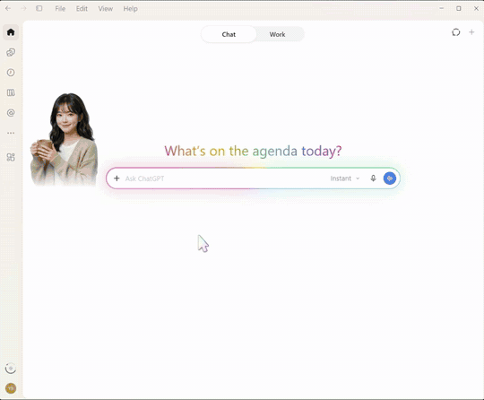
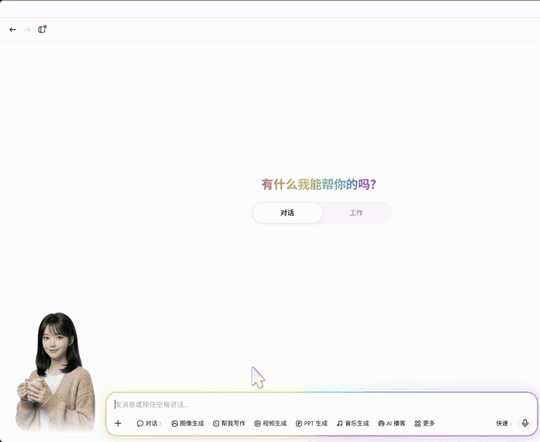
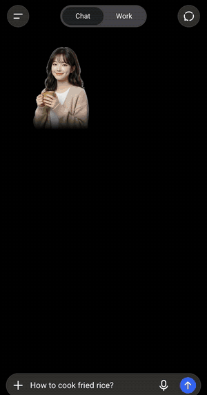
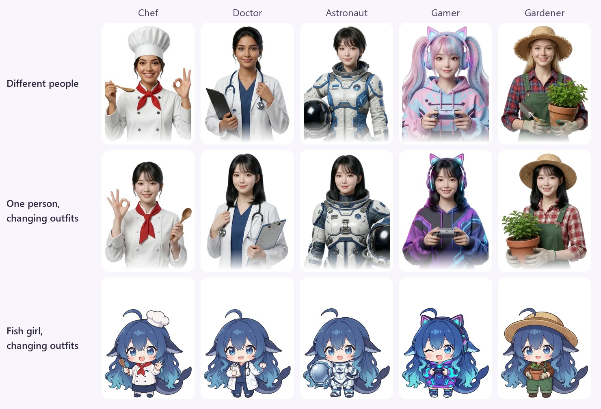
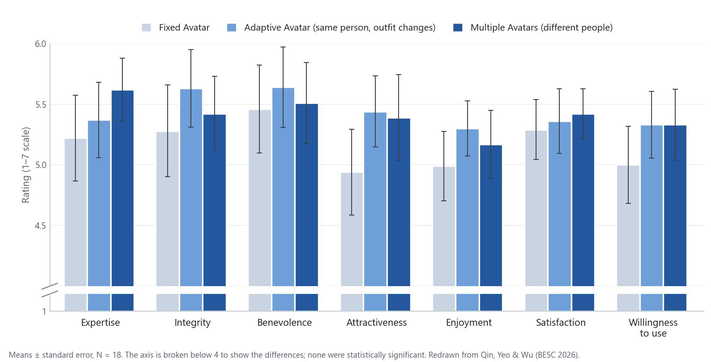
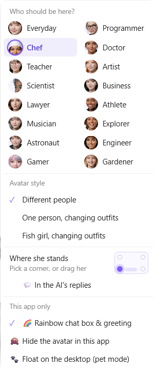
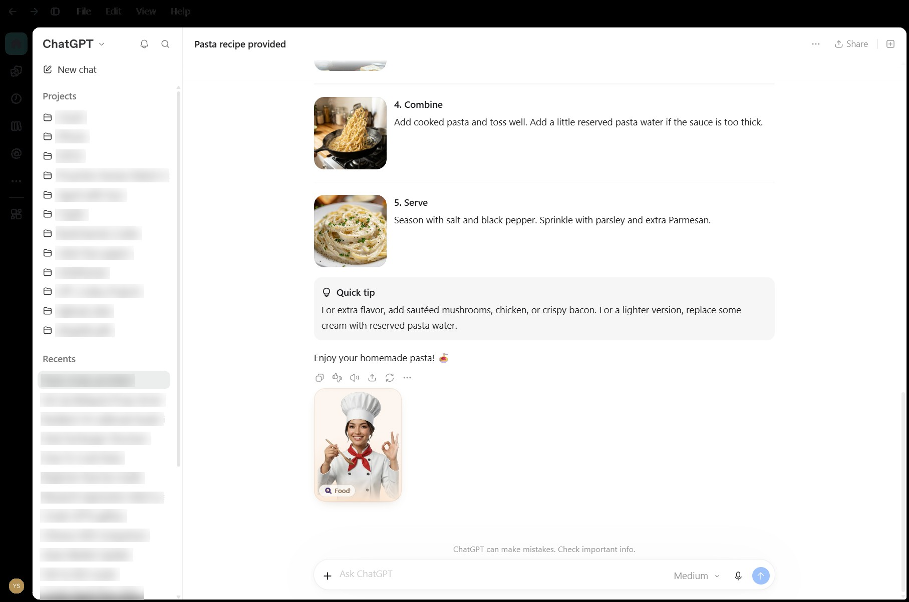
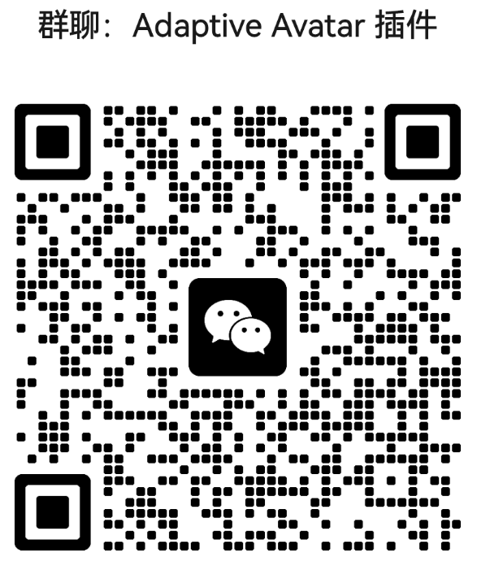

<p align="center"><a href="README.md">English</a> | <b>简体中文</b></p>
<h1 align="center"><br>Adaptive Agent Avatar</h1>

<p align="center">
<a href="#安装开箱即用的压缩包"></a>
<a href="#macos实验版"></a>
<a href="#android实验版"></a>
<a href="#浏览器扩展chrome--edge"></a>
</p>

<p align="center">
<a href="#支持的应用"></a>
<a href="#支持的应用"></a>
<a href="#支持的应用"></a>
<a href="#支持的应用"></a>
<a href="#支持的应用"></a>
<a href="#支持的应用"></a>
<a href="#支持的应用"></a>
<a href="#支持的应用"></a>
</p>

一个会根据你提问的话题**切换专业身份**的 AI 聊天头像。<br>
🍳 问怎么做炒饭，**厨师**就走进来。 &nbsp;🩺 问膝盖疼，**医生**就来接班。 &nbsp;🚀 问人类能不能住在火星上，**宇航员**就出现了。

我们知道，拟人化的形象比单纯的输入框更友好、更让人愿意交流，所以我们给 AI 加上了这样一个形象。然后我们更进一步：她会根据你问的话题切换职业，让你感觉是在和对口的专家聊天。看到对口的专家，可能会让人觉得 AI 的回答更专业、更可信。这个想法来自[我们的研究论文](#背后的研究)。

<table>
<tr>
<td width="41%"></td>
<td width="41%"></td>
<td width="18%"></td>
</tr>
<tr>
<td align="center"><b>在 Codex 里：</b>问意面菜谱来了厨师，问发烧来了医生，问月球来了宇航员</td>
<td align="center"><b>在豆包里：</b>小曼随话题换装：聊游戏是玩家，学吉他是音乐人，学数学是老师</td>
<td align="center"><b>在 Android 版 ChatGPT 里</b></td>
</tr>
</table>

这其实不是一只宠物。 她也可以像宠物一样浮在桌面上，但**暂时还**不会像宠物那样到处走动或玩耍。

**隐私优先。** 头像**从不**联网。一个小型 AI 模型（Google 的 EmbeddingGemma，130 MB）在你自己的处理器上判断每个问题的话题，只需几十毫秒，你的提问不会被保存或发送到任何地方。我们选了小模型，让它在任何电脑上都很快；也可以换成更大的模型，让话题判断更准确。桌面宠物运行在受限的沙盒中，无法访问网络或文件。

> **非官方项目，与字节跳动、OpenAI、腾讯、阿里巴巴、Anthropic、月之暗面（Kimi）、Cursor 和 DeepSeek 均无关联。** 它会修改你电脑上应用的页面，应用的条款可能不允许这样做。使用风险自负。
>
> 这是早期测试版。欢迎试用，并报告问题或提出改进建议。彩虹圈可以关掉。

## 快速开始

1. 在 [**Releases**](../../releases) 页面下载 **`AdaptiveAgentAvatar-v0.1.0-win-x64.zip`** 并解压（详见[安装](#安装开箱即用的压缩包)）。
2. 双击 **`Install.bat`**：添加 **AI Avatar** 快捷方式（桌面和开始菜单），并打开她的图标。
3. 点她的图标，会列出你已安装的应用。点其中一个，就会打开它并带上她，例如 **豆包：未打开 - 点击打开并显示头像**（英文界面为 *Doubao: closed - click to open with avatar*）。以后从 **AI Avatar** 快捷方式开始即可。
4. 像平常一样聊天，右键她可以换风格、换位置等。

**其他平台**：有早期的 Android 手机版和 macOS 版（见 [Android（实验版）](#android实验版)和 [macOS（实验版）](#macos实验版)）。

在 Chrome 或 Edge 里用 AI 聊天网站？请改用[浏览器扩展](#浏览器扩展chrome--edge)。

## 支持的应用

支持八个 Windows 桌面应用，以及 Chrome / Edge 里的 AI 聊天网站。按应用允许的方式，头像通过以下四种方法之一加入：

| 加入方式 | 应用（测试过的版本） | 怎么打开 | 原理 |
|---|---|---|---|
| **应用内** | ChatGPT Codex 桌面版（26.1027，Microsoft Store 版）<br>豆包桌面版（2.32）<br>元宝桌面版（2.90）<br>千问桌面版（5.1）<br>Cursor 桌面版（3.19） | 托盘图标 → 该应用 | 以调试端口打开应用，把她放进应用页面、输入框旁边。应用本身不会被修改。 |
| **悬浮窗** | Claude 桌面版（4.4212）<br>Kimi 桌面版（3.2） | 托盘图标 → Claude 或 Kimi | 它们不让她进入页面，所以她站在应用窗口上。小助手用屏幕阅读器的方法读取窗口。 |
| **插件** | DeepSeek Harness 桌面版（0.2） | 托盘图标 → DeepSeek Harness | 通过 DeepSeek Harness 自己的插件系统加入。 |
| **浏览器扩展** | ChatGPT、Claude、豆包、Kimi、Qwen、千问、元宝（Chrome 156），以及几乎任何可以用扩展里的按钮添加的 AI 聊天网站 | 单独下载 | 列出的网站直接可用。其他网站：点她的工具栏按钮 → **添加到这个网站**。 |

**浮在桌面上**：除了浏览器版，在所有应用里都可以右键她 → **🐾 浮在桌面上（宠物模式）**（Claude 是 **自由浮在桌面上**），右键菜单可以把她送回去。

## 功能

- **每个话题都有专家。** 共 16 个话题：编程、美食、健康、写作、艺术、研究、学习、商业、法律、健身、音乐、旅行、太空、工程、游戏、园艺。话题变了，当前的专家离开，对口的专家进来。像“再详细一点”这样的追问会保留同一位专家。新对话和闲聊（比如打招呼、问时间、问今天的天气）时是日常装扮。
- **三种风格**（右键她 → *头像风格*）：
  - **Different people（不同的人）：** 每个话题一位不同的专家。话题一变，当前的专家走出去，下一位专家走进来，就像她请来一位同事接手你的问题。
  - **One person, changing outfits（同一个人换装）：** 同一位女生小曼（Mandy），转个圈换上对应的服装。转圈动画还不够完美，我打算改进并重新渲染，但最近渲染额度用完了。
  - **Whale Girl, changing outfits（大肥鱼换装）：** 一条可爱的 Q 版大肥鱼（Whale Girl），同样有 16 套服装。她也还需要改进和重新渲染，原因同上。
- **每位都有名字**，显示在她下方的小名牌上。在“不同的人”风格里，每位专家都有自己的名字，例如厨师露西亚、程序员艾达、宇航员星遥；在她的菜单里把鼠标停在头像上就能看到。
- **她会对 AI 做出反应。** 思考时出现带圆点的玻璃气泡，输出时线条自己书写，完成时她点点头并出现对勾。气泡跟随应用的浅色或深色主题。
- **宠物模式。** 她可以离开应用窗口，浮在桌面上（浏览器版不行）。在桌面上她照样随话题切换、对 AI 做出反应。

<p align="center"></p>

## 背后的研究

这个项目源自我们的研究：

> Ziyang Qin, [Hui-Shyong Yeo](https://hci-yeo.github.io/), Man Wu. **Exploring the Effects of Avatar Attire Adaptation on User Perceptions of an LLM-Based Chatbot Across Professional Domains.** *Behavioural and Social Computing (BESC 2026)*, Lecture Notes in Computer Science 17177, Springer, 2027. [doi:10.1007/978-981-92-6916-7_18](https://doi.org/10.1007/978-981-92-6916-7_18)

**为什么做这个研究。** 拟人化的头像让聊天机器人比单纯的输入框更亲切、更让人愿意交流。现在人们会在同一次对话里请同一个聊天机器人帮忙做很不一样的事：菜谱、设计、代码、写故事。可聊天机器人通常只有一个固定的头像。如果每个任务换一个不同的智能体（“多智能体”设计），能体现专业性，却会打破“一直在和同一个助手说话”的感觉。我们想知道有没有折中的办法：保持同一张脸，让身份保持连续，只根据任务换上对应的服装。

**我们测试了什么。** 18 名参与者和一个基于大语言模型的聊天机器人一起完成四个领域的任务（烹饪、视觉设计、编程和文学创作，对应厨师、画家、程序员和作家的形象）。每位参与者都体验了三种条件：

- **Fixed Avatar（固定头像）：** 一个始终不变的头像。
- **Adaptive Avatar（自适应头像）：** 同一个人，随任务换装（即这里的“同一个人换装”风格）。
- **Multiple Avatars（多个头像）：** 每个领域换一个不同的人。也就是这里的 *Different people（不同的人）* 风格。

<p align="center"></p>

**我们发现了什么。** 各条件之间的差异都没有达到统计显著，效应量都很小（ηG² ≤ .024），所以这些只是趋势，不是定论。但趋势很一致：**两种换装的条件在全部七项指标上的评分都高于固定头像。** 自适应头像（同一个人换装）在正直、善意、吸引力和愉悦感上得分最高，在专业性上也高于固定头像。这说明“保持同一张脸、只换服装”在体现专业性和保持同一助手身份之间，可能是一种高效的平衡。

| 评分（1–7） | 专业性 | 正直 | 善意 | 吸引力 | 愉悦感 | 满意度 | 使用意愿 |
|---|---|---|---|---|---|---|---|
| 固定 | 5.22 | 5.28 | 5.46 | 4.94 | 4.99 | 5.29 | 5.00 |
| 自适应 | 5.37 | **5.63** | **5.64** | **5.44** | **5.30** | 5.36 | **5.33** |
| 多个 | **5.62** | 5.42 | 5.51 | 5.39 | 5.17 | **5.42** | **5.33** |

**为什么可能没有达到显著，以及这个项目改进了什么。** 除了样本量小，另外两名参与者的眼动观察显示，大家几乎不看头像：只占观看时间的不到 3%，因为头像放在角落里，离对话很远。论文建议今后用更大的样本、更醒目的头像呈现方式。这个项目就是我们对后一点的回应：头像就站在输入框旁边（或者在每条回答里），话题变化时走进来或转身换装，显示话题标签，并在 AI 思考和输出时做出反应，让人很难忽略她。

<details>
<summary>BibTeX</summary>

```bibtex
@inproceedings{qin2027attire,
  author    = {Qin, Ziyang and Yeo, Hui-Shyong and Wu, Man},
  title     = {Exploring the Effects of Avatar Attire Adaptation on User Perceptions
               of an {LLM}-Based Chatbot Across Professional Domains},
  booktitle = {Behavioural and Social Computing (BESC 2026)},
  series    = {Lecture Notes in Computer Science},
  volume    = {17177},
  pages     = {1--10},
  publisher = {Springer},
  year      = {2027},
  doi       = {10.1007/978-981-92-6916-7_18}
}
```

</details>

## 使用方法



- **正常聊天就好。** 话题变了，她就换人。刚启动后的第一个问题可能要等约 3 秒，AI 模型在加载。
- **右键她**打开菜单：
  - **请谁来？** 自己挑一位专家；下一个问题会重新挑选。
  - **头像风格：** 不同的人、同一个人换装，或大肥鱼。
  - **大小：** 小、标准、大或特大。
  - **她站在哪里：** 点一个角落，或者**拖动她**到任意位置。也可以选 **💬 在 AI 的回答里** 让她进入对话里（见[对话里的头像](#对话里的头像)）。
  - **仅限此应用：** 开关彩虹输入框、**在此应用中隐藏头像**，或 **🐾 浮在桌面上（宠物模式）**。
- **快速隐藏或显示她：** 在应用里按 **Alt+Shift+H**。隐藏时，输入框旁会有她头像的小圆按钮，点一下就能叫回她。
- **宠物模式：** 右键她 → **🐾 浮在桌面上（宠物模式）**。她会变成桌面上的一个透明小窗口，照样会换人、对 AI 做出反应。右键宠物 → **回到…窗口里** 可以把她送回应用里。
- **托盘图标**（时钟旁边她的头像；Windows 11 可能把它藏在 **^** 箭头里）：
  - 每个已安装的应用一行，显示她在那里的状态；点击即可打开应用并显示头像，或者隐藏她（例如 *豆包：未打开 - 点击打开并显示头像*）。
  - **重启头像** 能解决大多数问题。**关闭头像** 会把她从所有应用里移除但保留图标；**退出** 连图标一起关闭。
  - **开机自动启动** 让图标在开机后出现；**打开日志** 可以查看运行记录。
  - **Language / 语言：** English 或中文，用于托盘和她的菜单。
  - **反馈意见（打开网页）** 会在浏览器里打开一份简短的问卷。
- 每个应用都会记住自己的设置。

### 对话里的头像

除了站在角落里，她还可以**住进对话里**，每条 AI 回答都有自己的专家：右键她 → **💬 在 AI 的回答里**（每个应用单独设置，默认关闭；点一个角落就能换回来）。



- **每条回答都有自己的专家**，在回答左下角的小场景里，带一个话题标签（例如 🍳 Food）。以前的回答保留各自的专家，一眼就能看出谁答了什么。
- **最新的回答里是会动的头像**：她走进来、思考、书写，回答完成时点头。在 Codex 和 DeepSeek Harness 里，回答开始之前她会先在你的问题下面等着。
- **聊天会跟着她往下走**（AI 输出时），除非你往上翻。她不会挡住回答的文字。
- **可用的应用**：豆包、Codex、元宝、千问、DeepSeek Harness，以及浏览器里的 ChatGPT。Claude 暂时还不支持。

## 安装：开箱即用的压缩包

不需要另外安装任何东西：Node.js、AI 模型和其他所需文件都在压缩包里。

只在浏览器里用 AI 聊天？那不需要这个压缩包，请看下面的 [浏览器扩展（Chrome / Edge）](#浏览器扩展chrome--edge)，那是单独的下载。

**你需要：** Windows 10 或 11（64 位），上面至少一个应用，以及大约 **1 GB** 的空闲磁盘空间。

1. 打开 [**Releases**](../../releases) 页面，下载 **`AdaptiveAgentAvatar-v0.1.0-win-x64.zip`**（约 470 MB）。
2. 右键压缩包 → **全部解压缩**，选一个你会一直保留的文件夹，例如 `C:\AdaptiveAgentAvatar`。
   - 解压后不要移动这个文件夹：快捷方式、DeepSeek Harness 插件和 Claude Code 钩子都从这里运行。如果以后移动了，重新运行一次 `Install.bat`，这三样都会跟着更新。
3. 双击 **`Install.bat`**。它会在**桌面**和**开始菜单**添加 **AI Avatar** 快捷方式（她的头像），并在时钟旁边打开她的图标。Windows 11 可能把图标藏在 **^** 箭头里，可以把它拖到任务栏上常驻。
4. **以后请从 AI Avatar 快捷方式或时钟旁她的图标开始。** 点图标会出现你已安装应用的菜单，每行是应用、她的状态和点击后的操作，例如 **豆包：未打开 - 点击打开并显示头像**、**Claude：头像未开启 - 点击开启**。

`scripts` 文件夹里的 `Start ... .bat` 文件作用相同，可作备用（例如菜单里没有某个应用时）。下面各节会详细介绍每个应用。

### 豆包、Codex、元宝、千问和 Cursor

1. 点她的托盘图标 → 选应用，例如 **豆包：未打开 - 点击打开并显示头像**。也可以双击 `scripts` 里对应的 Start 文件（`Start Doubao with Avatar.bat`、`Start Codex with Avatar.bat`、`Start Yuanbao with Avatar.bat`、`Start Qianwen with Avatar.bat` 或 `Start Cursor with Avatar.bat`）。
   - 如果应用已经打开，它会**先询问再重启**应用，因为重启会丢失还没发送的消息或正在生成的回答。
2. 头像会出现在输入框左边，时钟旁边也会出现一个 **AI Avatar** 小图标（她的头像）。问个问题，看她换人。在 Cursor 里，她站在 Agent 面板的输入框旁边。

**以后请从她的托盘图标（或 Start 文件）打开应用**，不要从开始菜单打开：普通方式打开的应用里没有头像。如果应用已经开着，在托盘菜单里点它那一行即可加上她。

### Claude（桌面版）

她是 Claude 输入框旁边的[悬浮窗](#支持的应用)，Chat 和 Code 标签页都能用，Claude 不需要重启。

1. 托盘图标 → **Claude：头像未开启 - 点击开启**（或 `scripts\Start Claude Avatar.bat`），再打开 Claude。
2. 发一条消息，她就会换成对应的专家。

- **原理**：一个小助手像屏幕阅读器一样读取 Claude 的窗口（输入框、Stop 按钮、你的消息）。你的消息只交给本地模型，不会被保存，Claude 本身也不会被改动。
- **关闭**：右键她 → **Hide her (turn the Claude pet off)**，或在托盘菜单里点她那一行。电脑重启后，在托盘图标里重新开启即可。
- **Claude Code（可选）**：`scripts\Connect Claude Code.bat` 会在 `%USERPROFILE%\.claude\settings.json` 里加入四个钩子（会先备份），之后每个会话开始时她会自动启动，Claude 使用工具时显示“工作中”。`scripts\Disconnect Claude Code.bat` 可以去掉。
- **杀毒软件**可能会提示这个隐藏的 PowerShell 助手（`pet\claude-dock.cs`，代码可查看）。如果被拦截，只有 Claude 和 Kimi 的头像会失效。

### Kimi（桌面版）

和 Claude 用同样的悬浮窗和小助手。Kimi 不需要重启。

1. 托盘图标 → **Kimi：头像未开启 - 点击开启**（或 `scripts\Start Kimi Avatar.bat`），再打开 Kimi。
2. 发一条消息，她就会换成对应的专家；Kimi 回答时，她会显示思考气泡。

- **关闭**：右键她 → **Hide her (turn the Kimi pet off)**，或在托盘菜单里点她那一行。电脑重启后，在托盘图标里重新开启即可。
- Kimi 只向屏幕阅读器提供窗口信息，所以小助手像屏幕阅读器那样读取。Kimi 本身不会被修改。

### DeepSeek Harness

1. 点她的托盘图标 → **DeepSeek Harness：未打开 - 点击打开并显示头像**（或双击 `scripts\Start DeepSeek Harness with Avatar.bat`）。第一次运行时，它会把头像加成一个从这个文件夹运行的插件。如果当时 DeepSeek Harness 已经开着，重启它才能看到她。
2. 之后无论怎么打开 DeepSeek Harness，她都会自动加载。

话题模型运行在单独的辅助进程里，不会让 DeepSeek Harness 崩溃。`scripts\Remove DeepSeek Harness plugin.bat` 可以移除插件。

**删除这个文件夹之前**，请先运行 `Uninstall.bat`，否则 DeepSeek Harness 可能无法启动。移动之后，重新运行一次 `Install.bat`。如果它已经打不开了，请把文件夹放回原处，或在命令提示符里运行一次：

```bat
"%LOCALAPPDATA%\Programs\DeepSeek Harness\resources\runtime\cli\bin\dsh.cmd" plugin --profile desktop remove @local/ai-avatar
```

### 如果 Windows 或杀毒软件提示

- **“Windows 已保护你的电脑”**（蓝色的 SmartScreen 窗口）：点 **更多信息** → **仍要运行**。出现这个提示是因为文件是新的、没有数字签名，而不是发现了有害内容。
- **杀毒软件扫描：** 压缩包里有两个程序：`node\node.exe`（Node.js）和 `pet\node_modules\electron\dist\electron.exe`（Electron，VS Code 和 Discord 也基于它）。两者都是官方原版，扫描应该能通过。如果被拦截，请截图发给我。

## 浏览器、Android 和 macOS

### 浏览器扩展（Chrome / Edge）

这是 AI 聊天网站的浏览器扩展：ChatGPT、Claude、豆包（以及国际版 Dola）、Kimi、Qwen、千问和元宝，以及你自己添加的几乎任何 AI 聊天网站。它需要单独下载：自带一份动画片段和 AI 模型，所以不需要上面的压缩包。

1. 在 [**Releases**](../../releases) 页面下载 **`AdaptiveAgentAvatar-v0.1.0-browser-extension.zip`**（约 270 MB）并解压。
2. 把 **`AdaptiveAgentAvatar-Extension`** 文件夹放到一个固定的位置，例如 `C:\AdaptiveAgentAvatar-Extension`。浏览器会直接从这里运行它。
3. 打开 `chrome://extensions`（Chrome）或 `edge://extensions`（Edge），打开 **开发者模式**。
4. 点 **加载已解压的扩展程序**，选择 `AdaptiveAgentAvatar-Extension` 文件夹。
5. 打开上面任一网站。她就站在输入框旁边；右键她可以换风格和设置。

**其他 AI 聊天网站**（例如 Grok 或 Manus）：打开网站，点扩展的工具栏按钮（她的头像；可以在拼图图标的菜单里固定）→ **添加到这个网站**，浏览器询问时允许访问这一个网站。如果她站错了输入框，选 **选择聊天输入框** 再点正确的输入框。**从这个网站移除** 可以把她撤下。

- 这个扩展只能访问上面这些网站和你添加的网站，话题模型在扩展内部、在你的浏览器里运行。较新的电脑会用显卡计算，每个问题大约 30 毫秒。
- 不是从商店安装的扩展需要打开**开发者模式**，浏览器可能会提醒你。这是正常的，保持打开即可。
- 浏览器版没有宠物模式。
- **卸载：** 在扩展页面移除它，再删除文件夹。

### Android（实验版）

一个较新、还不太完善的附带项目。手机上的 **AI Avatar** 应用以悬浮窗的形式，把她放在 **ChatGPT、豆包（以及 Cici）、Claude、元宝、千问、DeepSeek 和 Kimi** 的输入框旁边：借助 Android 的无障碍功能，它只在这些应用里读取输入框、你的问题以及 AI 是否在回答。话题模型在手机上运行，应用没有联网权限。

1. 在 [**Releases**](../../releases) 页面把 **`AdaptiveAgentAvatar-v0.1.0-android.apk`** 下载到手机并打开（如果提示，请允许安装应用）。
2. 打开 **AI Avatar** → **开启**，打开她的开关，再点 **允许**。如果开关是灰色的：**应用信息** → **⋮** → **允许受限制的设置**。
3. 打开支持的聊天应用。长按她打开菜单，拖动可以移动她。

已在三星、华为和 vivo 上测试。如果应用更新后她被关掉，重新开启即可。不在 Google Play 上；没有 iPhone 版（iOS 不允许悬浮窗）。

### macOS（实验版）

早期的 Mac 版：支持应用内的那几个应用（Codex，在 Mac 上叫“ChatGPT”；豆包、元宝、千问和 Cursor）以及宠物模式。适用于 Apple 芯片的 Mac（M1 及以后），macOS 12 或更新版本。Mac 上暂不支持 Claude 和 Kimi。

**现成的应用**：

1. 在 [**Releases**](../../releases) 页面下载 **`AdaptiveAgentAvatar-v0.1.0-mac-arm64.zip`**，解压后，把 **AI Avatar** 拖到 **应用程序** 文件夹。
2. 双击打开。第一次打开时，macOS 会提示无法检查这个应用，因为它没有 Apple 开发者账号的签名。点 **完成**，打开 **系统设置 → 隐私与安全性**，向下滚动到有关 AI Avatar 的那一行，点 **仍要打开**，再输入你的 Mac 密码确认。之后就能正常打开了。
3. 她的头像会出现在屏幕顶部的菜单栏里：点它即可选择要打开的应用。要移除她：她的菜单 → **卸载 AI Avatar…**。

**或者自己构建**，这样也不会出现上面的提示（在你自己的 Mac 上构建的应用不会被标记为下载的文件）。你也可以先让 AI 助手帮你读一遍代码。

1. 安装 [Node.js](https://nodejs.org) 22 或更新版本，以及 Apple 的命令行工具（在“终端”里运行 `xcode-select --install`）。
2. 获取本项目的源代码（见[开发者：从源代码运行](#开发者从源代码运行)），并把 Windows 压缩包里的 `models` 文件夹复制进去：AI 模型太大，放不进 GitHub；没有它，她会用关键词列表判断话题。
3. 在“终端”里，进入项目文件夹运行：
   ```bash
   bash mac/start.sh --install   # 下载 AI 库和 Electron（约 250 MB）
   bash mac/build-app.sh         # 生成 dist/AI Avatar.app 和 dist/AI-Avatar-mac.zip
   ```
4. 把 `dist/AI Avatar.app` 拖到 **应用程序** 文件夹，双击打开。

## 关闭和卸载

- **全部关闭：** 托盘图标 → **关闭头像**（或 **退出**，它还会关闭托盘图标），或双击 **`scripts\Turn Avatar Off.bat`**。这会关闭豆包、Codex、元宝、千问、Cursor 里的头像以及 Claude 和 Kimi 的悬浮窗；托盘图标 → **重新开启头像** 可以重新打开。DeepSeek Harness 的插件会一直保留，直到你移除它。
- **卸载：** 双击 **`Uninstall.bat`**，然后删除整个文件夹。它会先询问，然后：
  - 关闭托盘图标，并在所有应用里关闭头像；
  - 移除 DeepSeek Harness 插件（仅当它从这个文件夹运行时）和 Claude Code 钩子（如果添加过）；
  - 删除 **AI Avatar** 快捷方式、**开机自动启动**，以及两个小的设置文件夹（`%APPDATA%\ai-avatar-tray` 和 `%APPDATA%\doubao-mods-pet`）。

  `Install.bat` 在文件夹之外只添加这两个快捷方式，聊天应用本身也从未被修改。

## 隐私和安全

- **不联网。** 头像只和你电脑上的应用通信，话题模型在你的处理器上运行。你的提问从不会被保存或发送到任何地方，日志（`mods-log.txt`）也从不包含你写的内容。（当然，聊天应用本身照常联网。）
- **尽量放进沙盒。** 桌面宠物运行在 Electron 的沙盒里（不能访问文件，不能联网），浏览器扩展运行在浏览器的沙盒里。后台程序、托盘图标和 Claude/Kimi 小助手是普通程序，代码都在这个文件夹里。
- **应用不会被修改。** 她是从外部加进去的：通过调试端口、悬浮窗或插件。
- **请只在自己的电脑上使用。** 应用带着头像运行时，这台电脑上的其他程序可以通过调试端口控制它，包括它的登录信息。这对 **Codex** 最重要，因为它能执行命令。用完后请关闭应用，不要在共用的电脑上使用头像。

## 已知限制

**软件更新后可能无法使用。**
头像能显示，是因为豆包、Codex、元宝、千问和 Cursor 目前保留了内置的调试功能。它们随时可以在更新中关闭该功能或修改页面，不会事先通知。如果发生这种情况，应用本身照常使用，只是头像不再出现，你的电脑和账号都不会受影响。

## 常见问题

| 问题 | 试试这个 |
|---|---|
| 时钟旁没有她的图标 | 双击桌面上的 **AI Avatar** 快捷方式。Windows 11 可能把图标藏在 **^** 箭头里。 |
| 豆包、Codex、元宝、千问或 Cursor 里没有头像 | 托盘图标 → 点这个应用。普通方式打开的应用里没有头像。 |
| Claude 上没有头像 | 托盘图标 → 点 **Claude** 开启她（要用桌面版，不是网页版）。 |
| Kimi 上没有头像 | 托盘图标 → 点 **Kimi** 开启她（要用桌面版，不是网页版）。 |
| DeepSeek Harness 里没有头像 | 关闭它，再点托盘图标 → **DeepSeek Harness**。移动过文件夹？重新运行 `Install.bat`。 |
| 托盘菜单里没有某个应用 | 菜单只列出检测到已安装的应用。请改用 `scripts` 里该应用的 Start 文件。 |
| 她不再有反应 | 托盘图标 → **重启头像**。 |
| AI 聊天网站上没有头像 | 在扩展页面确认扩展已打开，再刷新页面。不在列表里的网站，请先用扩展的工具栏按钮添加。 |
| Codex 无法带着头像启动 | 必须是 Microsoft Store 里的 Codex 桌面版（Windows 上唯一的版本）。不支持 Codex 命令行和 VS Code 扩展。 |
| 提示 “Node.js 22 or newer is needed” | 你下载的是源代码，不是发布的压缩包。请从 Releases 页面下载压缩包。 |
| 其他问题 | 托盘图标 → **打开日志**，把 `mods-log.txt` 发给我（里面没有聊天内容）。 |

## 开发者：从源代码运行

```
git clone https://github.com/hci-yeo/AdaptiveAgentAvatar.git
```

然后安装 [Node.js](https://nodejs.org) 22 或更新版本，双击任意 Start 文件。第一次运行会安装 AI 库（`npm install`，约 70 MB）以及托盘和宠物用的 Electron（约 360 MB）。

最好的话题模型（裁剪过的 EmbeddingGemma）是一个 130 MB 的文件，超过了 GitHub 仓库单个文件 100 MB 的限制，所以不在 git 里。没有它时，头像会用简单的关键词列表判断话题（不会下载任何东西）。把发布压缩包里的 `models` 文件夹复制到项目文件夹，应用和 DeepSeek Harness 插件就能用上真正的模型。

构建其他部分：

- **DeepSeek Harness 插件**：`node integrations/deepseek-harness/build.mjs`（它的 `client.js` 不在 git 里；缺少时 DeepSeek Harness 启动文件会自动构建）。
- **浏览器扩展**：`node browser-extension/build.mjs`（需要 `models` 文件夹；详见它的 README）。
- **Android 应用**：先构建浏览器扩展，再运行 `node android/build-assets.mjs` 和 `android\gradlew.bat assembleRelease`（需要 Android SDK 和 JDK）。

在应用打开时修改 `mods/` 里的文件，改动会立即生效。

## AI 模型的使用条款

下载包里包含 Google [EmbeddingGemma 300M](https://huggingface.co/google/embeddinggemma-300m) 的修改版（词表裁剪为中文和英文）。使用它即表示你同意：

- **Gemma 依照 [Gemma 使用条款](https://ai.google.dev/gemma/terms)（Gemma Terms of Use）提供，并受其约束。**
- **不得将它用于 [Gemma 禁止使用政策](https://ai.google.dev/gemma/prohibited_use_policy)（Gemma Prohibited Use Policy）中列出的任何用途**；如果你把它转给他人，必须同时附上这些条款。
- 两者的副本以及修改说明，在桌面版压缩包和浏览器扩展里的 `models\local\embeddinggemma-300m-zh-en\` 中（`GEMMA_TERMS.txt` 和 `NOTICE.txt`）。

## 致谢和许可

- **话题模型：** Google 的 EmbeddingGemma 300M，依照 Gemma 使用条款提供（见上文）。
- **库和程序：** [Transformers.js](https://github.com/huggingface/transformers.js)（Apache 2.0）、[ONNX Runtime](https://github.com/microsoft/onnxruntime)（MIT，许可证在 `licenses\` 中）、[Electron](https://www.electronjs.org)（MIT）和 [Node.js](https://nodejs.org)（MIT，许可证在发布压缩包的 `node\LICENSE` 中）。
- **本项目的代码**采用 [MIT 许可证](LICENSE)：可以自由使用、修改和分享，但要保留版权声明。
- **本项目的美术素材**（各位专家形象、服装、大肥鱼、动画和图标）采用 [CC BY-NC 4.0](LICENSE-ART)：可以分享和改编，但要注明出处，且不得用于商业用途。具体包括哪些文件见 [LICENSE-ART](LICENSE-ART)。

## 支持与交流

<table>
<tr>
<td>

如果你喜欢这个项目，欢迎赞助，帮助我们开展有偿的用户研究。<br>
想聊聊它，欢迎扫码加入微信群。

<a href="https://github.com/sponsors/hci-yeo"></a>
<a href="mailto:golfyeo2019@gmail.com"></a>

</td>
<td width="190" align="center"></td>
</tr>
</table>
